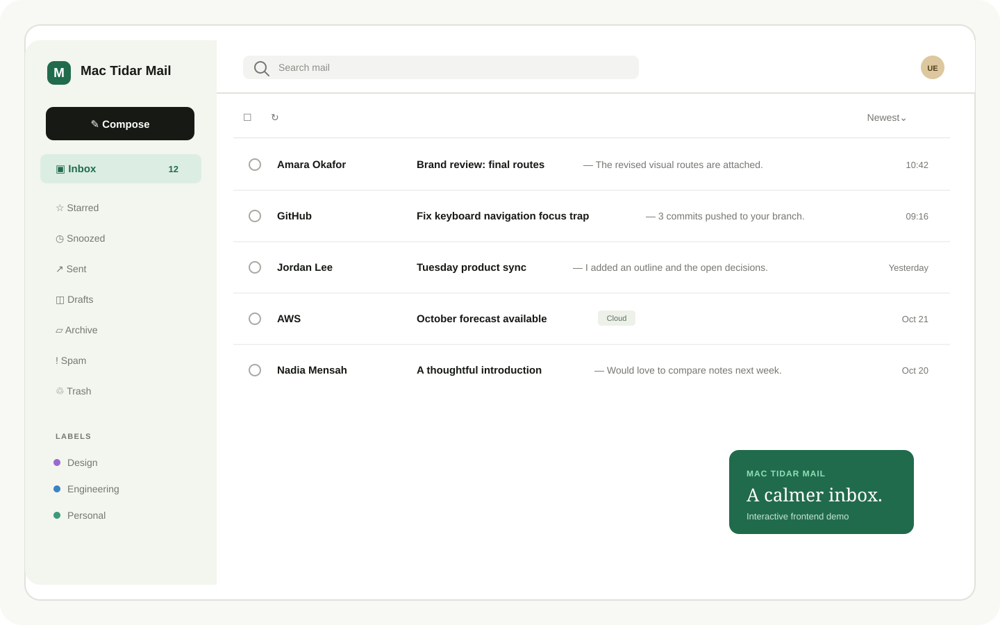

# Mac Tidar Mail

Frontend-only Mac Tidar Mail product demo and marketing homepage.

## Product preview




The inbox preview mirrors the working demo’s forest, mint, linen, and charcoal design system. The demo includes realistic local mail data, folders, labels, search, compose, and browser-local persistence.

## Stack

- Next.js App Router + TypeScript
- Tailwind CSS 4 available for utility styling; the existing visual system is implemented with scoped CSS tokens
- Static export (`next build`) for deployment
- Browser-local demo state only; no backend, database, API, external authentication, or email delivery is connected

## Routes

- `/` — marketing homepage
- `/app/` — interactive mail demo with local demo data and browser persistence

## Run locally

```bash
npm install
npm run dev
```

## Build

```bash
npm run build
```

The static deployment output is generated in `out/`.
